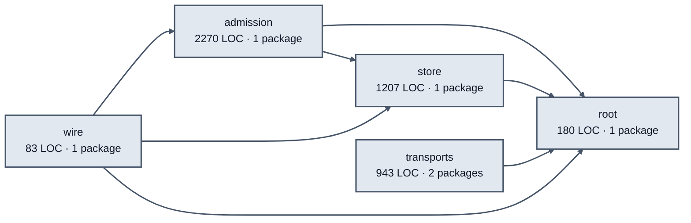

# agent messages service architecture

<!-- Generated by make architecture. -->

Source commit: `cefac1798c8fbd436055936a81f65d202704eee7`.

[High-level backend](../high-level-backend.md) · [Test coverage](../high-level-test-coverage.md)

4683 LOC across 33 files. Arrows show imports between package groups within this service. They are static dependencies, not runtime calls. `XX%` means coverage was unmeasured.

## Package groups

`(subservice)` identifies a private service under `internal/services/`. `internal/service` is the core service implementation.

| Group | LOC | Files | Packages | Unit | Functional |
| --- | ---: | ---: | ---: | ---: | ---: |
| admission | 2270 | 12 | 1 | 89.7% | 87.5% |
| store | 1207 | 7 | 1 | 90.6% | 80.6% |
| root | 180 | 5 | 1 | 100.0% | 80.0% |
| transports | 943 | 8 | 2 | 89.8% | 64.7% |
| wire | 83 | 1 | 1 | XX% | 66.7% |

## Packages

| Package | LOC | Files | Unit | Functional |
| --- | ---: | ---: | ---: | ---: |
| [`pkg/services/agent_messages`](../../../../pkg/services/agent_messages) | 180 | 5 | 100.0% | 80.0% |
| [`pkg/services/agent_messages/internal/admission`](../../../../pkg/services/agent_messages/internal/admission) | 2270 | 12 | 89.7% | 87.5% |
| [`pkg/services/agent_messages/internal/store`](../../../../pkg/services/agent_messages/internal/store) | 1207 | 7 | 90.6% | 80.6% |
| [`pkg/services/agent_messages/transports/cli`](../../../../pkg/services/agent_messages/transports/cli) | 662 | 5 | 88.6% | 59.9% |
| [`pkg/services/agent_messages/transports/http`](../../../../pkg/services/agent_messages/transports/http) | 281 | 3 | 92.3% | 75.0% |
| [`pkg/services/agent_messages/wire`](../../../../pkg/services/agent_messages/wire) | 83 | 1 | XX% | 66.7% |
