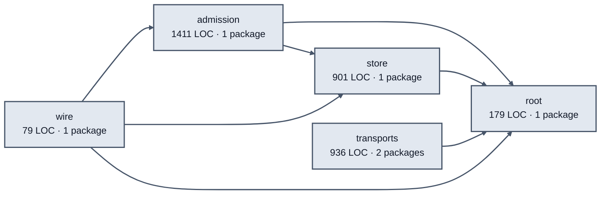

# agent messages service architecture

<!-- Generated by make architecture. -->

Source commit: `bda103cc0506f4745e7d454b453cce19e3b4010b`.

[High-level backend](../high-level-backend.md) · [Test coverage](../high-level-test-coverage.md)

3506 LOC across 31 files. Arrows show imports between package groups within this service. They are static dependencies, not runtime calls. `XX%` means coverage was unmeasured.

## Package groups

`(subservice)` identifies a private service under `internal/services/`. `internal/service` is the core service implementation.

| Group | LOC | Files | Packages | Unit | Functional |
| --- | ---: | ---: | ---: | ---: | ---: |
| admission | 1411 | 11 | 1 | 90.8% | 80.8% |
| store | 901 | 6 | 1 | 92.1% | 78.0% |
| root | 179 | 5 | 1 | 100.0% | 80.0% |
| transports | 936 | 8 | 2 | 90.1% | 63.1% |
| wire | 79 | 1 | 1 | XX% | 66.7% |

## Packages

| Package | LOC | Files | Unit | Functional |
| --- | ---: | ---: | ---: | ---: |
| [`pkg/services/agent_messages`](../../../../pkg/services/agent_messages) | 179 | 5 | 100.0% | 80.0% |
| [`pkg/services/agent_messages/internal/admission`](../../../../pkg/services/agent_messages/internal/admission) | 1411 | 11 | 90.8% | 80.8% |
| [`pkg/services/agent_messages/internal/store`](../../../../pkg/services/agent_messages/internal/store) | 901 | 6 | 92.1% | 78.0% |
| [`pkg/services/agent_messages/transports/cli`](../../../../pkg/services/agent_messages/transports/cli) | 655 | 5 | 89.0% | 57.9% |
| [`pkg/services/agent_messages/transports/http`](../../../../pkg/services/agent_messages/transports/http) | 281 | 3 | 92.3% | 74.4% |
| [`pkg/services/agent_messages/wire`](../../../../pkg/services/agent_messages/wire) | 79 | 1 | XX% | 66.7% |
