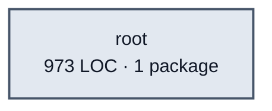

# edges service architecture

<!-- Generated by make architecture. -->

Source commit: `c32b8f5b6bf496d006449043be3a076868ac313f`.

[High-level backend](../high-level-backend.md) · [Test coverage](../high-level-test-coverage.md)

973 LOC across 2 files. Arrows show imports between package groups within this service. They are static dependencies, not runtime calls. `XX%` means coverage was unmeasured.

## Package groups

`(subservice)` identifies a private service under `internal/services/`. `internal/service` is the core service implementation.

| Group | LOC | Files | Packages | Unit | Functional |
| --- | ---: | ---: | ---: | ---: | ---: |
| root | 973 | 2 | 1 | 73.6% | 85.8% |

## Packages

| Package | LOC | Files | Unit | Functional |
| --- | ---: | ---: | ---: | ---: |
| [`pkg/services/edges`](../../../../pkg/services/edges) | 973 | 2 | 73.6% | 85.8% |
