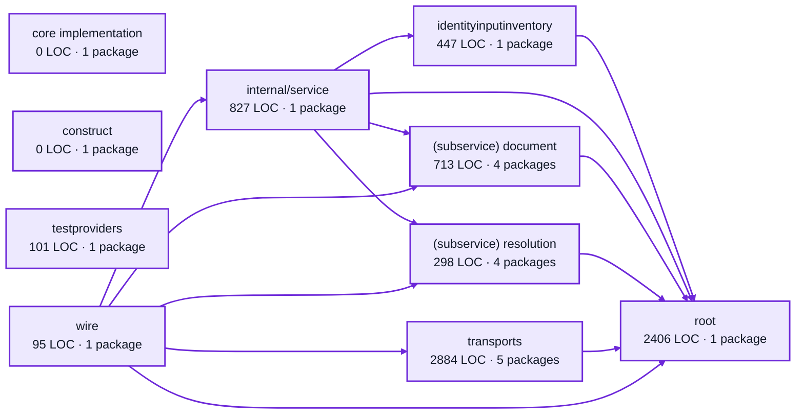

# operator settings service architecture

<!-- Generated by make architecture. -->

Source commit: `feca951b98e7a637d2d9120d3d497fd5210d6370`.

[High-level backend](../high-level-backend.md) · [Test coverage](../high-level-test-coverage.md)

7771 LOC across 74 files. Arrows show imports between package groups within this service. They are static dependencies, not runtime calls. `XX%` means coverage was unmeasured.

## Package groups

`(subservice)` identifies a private service under `internal/services/`. `internal/service` is the core service implementation.

| Group | LOC | Files | Packages | Unit | Functional |
| --- | ---: | ---: | ---: | ---: | ---: |
| core implementation | 0 | 0 | 1 | XX% | XX% |
| construct | 0 | 0 | 1 | XX% | XX% |
| identityinputinventory | 447 | 6 | 1 | 100.0% | 0.0% |
| internal/service | 827 | 4 | 1 | 80.1% | 56.1% |
| (subservice) document | 713 | 11 | 4 | 95.8% | 78.7% |
| (subservice) resolution | 298 | 6 | 4 | 95.4% | 73.2% |
| testproviders | 101 | 1 | 1 | 97.0% | XX% |
| root | 2406 | 14 | 1 | 88.8% | 41.5% |
| transports | 2884 | 28 | 5 | 90.4% | 64.9% |
| wire | 95 | 4 | 1 | XX% | 80.0% |

## Packages

| Package | LOC | Files | Unit | Functional |
| --- | ---: | ---: | ---: | ---: |
| [`pkg/services/operator_settings`](../../../../pkg/services/operator_settings) | 2406 | 14 | 88.8% | 41.5% |
| [`pkg/services/operator_settings/internal`](../../../../pkg/services/operator_settings/internal) | 0 | 0 | XX% | XX% |
| [`pkg/services/operator_settings/internal/construct`](../../../../pkg/services/operator_settings/internal/construct) | 0 | 0 | XX% | XX% |
| [`pkg/services/operator_settings/internal/identityinputinventory`](../../../../pkg/services/operator_settings/internal/identityinputinventory) | 447 | 6 | 100.0% | 0.0% |
| [`pkg/services/operator_settings/internal/service`](../../../../pkg/services/operator_settings/internal/service) | 827 | 4 | 80.1% | 56.1% |
| [`pkg/services/operator_settings/internal/services/document`](../../../../pkg/services/operator_settings/internal/services/document) | 25 | 2 | XX% | XX% |
| [`pkg/services/operator_settings/internal/services/document/identityinventory`](../../../../pkg/services/operator_settings/internal/services/document/identityinventory) | 243 | 3 | 100.0% | XX% |
| [`pkg/services/operator_settings/internal/services/document/internal/service`](../../../../pkg/services/operator_settings/internal/services/document/internal/service) | 424 | 5 | 95.3% | 78.5% |
| [`pkg/services/operator_settings/internal/services/document/wire`](../../../../pkg/services/operator_settings/internal/services/document/wire) | 21 | 1 | XX% | 100.0% |
| [`pkg/services/operator_settings/internal/services/resolution`](../../../../pkg/services/operator_settings/internal/services/resolution) | 11 | 1 | XX% | XX% |
| [`pkg/services/operator_settings/internal/services/resolution/defaults`](../../../../pkg/services/operator_settings/internal/services/resolution/defaults) | 34 | 2 | 100.0% | XX% |
| [`pkg/services/operator_settings/internal/services/resolution/internal/service`](../../../../pkg/services/operator_settings/internal/services/resolution/internal/service) | 240 | 2 | 95.1% | 72.8% |
| [`pkg/services/operator_settings/internal/services/resolution/wire`](../../../../pkg/services/operator_settings/internal/services/resolution/wire) | 13 | 1 | XX% | 100.0% |
| [`pkg/services/operator_settings/internal/testproviders`](../../../../pkg/services/operator_settings/internal/testproviders) | 101 | 1 | 97.0% | XX% |
| [`pkg/services/operator_settings/transports/cli`](../../../../pkg/services/operator_settings/transports/cli) | 342 | 4 | 82.4% | 71.8% |
| [`pkg/services/operator_settings/transports/cli/initsetup`](../../../../pkg/services/operator_settings/transports/cli/initsetup) | 72 | 1 | 66.7% | 86.7% |
| [`pkg/services/operator_settings/transports/globalconfig`](../../../../pkg/services/operator_settings/transports/globalconfig) | 999 | 4 | 96.6% | 84.8% |
| [`pkg/services/operator_settings/transports/http`](../../../../pkg/services/operator_settings/transports/http) | 658 | 11 | 88.2% | XX% |
| [`pkg/services/operator_settings/transports/mcp`](../../../../pkg/services/operator_settings/transports/mcp) | 813 | 8 | 82.3% | 3.1% |
| [`pkg/services/operator_settings/wire`](../../../../pkg/services/operator_settings/wire) | 95 | 4 | XX% | 80.0% |
