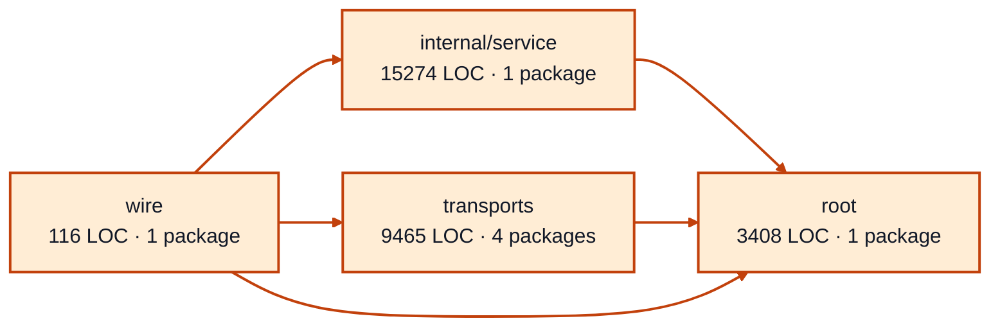

# worker sessions service architecture

<!-- Generated by make architecture. -->

Source commit: `81714c496836a0a87d7ce60c60f09734faeba9a0`.

[High-level backend](../high-level-backend.md) · [Test coverage](../high-level-test-coverage.md)

28263 LOC across 84 files. Arrows show imports between package groups within this service. They are static dependencies, not runtime calls. `XX%` means coverage was unmeasured.

## Package groups

`(subservice)` identifies a private service under `internal/services/`. `internal/service` is the core service implementation.

| Group | LOC | Files | Packages | Unit | Functional |
| --- | ---: | ---: | ---: | ---: | ---: |
| internal/service | 15274 | 41 | 1 | 92.9% | 74.2% |
| root | 3408 | 10 | 1 | 98.1% | 73.5% |
| transports | 9465 | 30 | 4 | 81.0% | 73.4% |
| wire | 116 | 3 | 1 | XX% | 81.8% |

## Packages

| Package | LOC | Files | Unit | Functional |
| --- | ---: | ---: | ---: | ---: |
| [`pkg/services/worker_sessions`](../../../../pkg/services/worker_sessions) | 3408 | 10 | 98.1% | 73.5% |
| [`pkg/services/worker_sessions/internal/service`](../../../../pkg/services/worker_sessions/internal/service) | 15274 | 41 | 92.9% | 74.2% |
| [`pkg/services/worker_sessions/transports/cli`](../../../../pkg/services/worker_sessions/transports/cli) | 4883 | 14 | 80.1% | 71.8% |
| [`pkg/services/worker_sessions/transports/cli/worker_sessions`](../../../../pkg/services/worker_sessions/transports/cli/worker_sessions) | 30 | 1 | 100.0% | 0.0% |
| [`pkg/services/worker_sessions/transports/http`](../../../../pkg/services/worker_sessions/transports/http) | 3809 | 11 | 79.4% | 72.9% |
| [`pkg/services/worker_sessions/transports/mcp`](../../../../pkg/services/worker_sessions/transports/mcp) | 743 | 4 | 93.9% | 85.0% |
| [`pkg/services/worker_sessions/wire`](../../../../pkg/services/worker_sessions/wire) | 116 | 3 | XX% | 81.8% |
