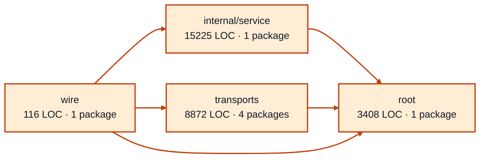

# worker sessions service architecture

<!-- Generated by make architecture. -->

Source commit: `b3f0019c5ad43df5426626442fbc98feaf4c6903`.

[High-level backend](../high-level-backend.md) · [Test coverage](../high-level-test-coverage.md)

27621 LOC across 81 files. Arrows show imports between package groups within this service. They are static dependencies, not runtime calls. `XX%` means coverage was unmeasured.

## Package groups

`(subservice)` identifies a private service under `internal/services/`. `internal/service` is the core service implementation.

| Group | LOC | Files | Packages | Unit | Functional |
| --- | ---: | ---: | ---: | ---: | ---: |
| internal/service | 15225 | 41 | 1 | 92.9% | 72.8% |
| root | 3408 | 10 | 1 | 98.1% | 73.5% |
| transports | 8872 | 27 | 4 | 80.1% | 72.7% |
| wire | 116 | 3 | 1 | XX% | 81.8% |

## Packages

| Package | LOC | Files | Unit | Functional |
| --- | ---: | ---: | ---: | ---: |
| [`pkg/services/worker_sessions`](../../../../pkg/services/worker_sessions) | 3408 | 10 | 98.1% | 73.5% |
| [`pkg/services/worker_sessions/internal/service`](../../../../pkg/services/worker_sessions/internal/service) | 15225 | 41 | 92.9% | 72.8% |
| [`pkg/services/worker_sessions/transports/cli`](../../../../pkg/services/worker_sessions/transports/cli) | 4560 | 12 | 79.1% | 71.1% |
| [`pkg/services/worker_sessions/transports/cli/worker_sessions`](../../../../pkg/services/worker_sessions/transports/cli/worker_sessions) | 30 | 1 | 100.0% | 0.0% |
| [`pkg/services/worker_sessions/transports/http`](../../../../pkg/services/worker_sessions/transports/http) | 3639 | 10 | 78.7% | 72.5% |
| [`pkg/services/worker_sessions/transports/mcp`](../../../../pkg/services/worker_sessions/transports/mcp) | 643 | 4 | 93.1% | 84.8% |
| [`pkg/services/worker_sessions/wire`](../../../../pkg/services/worker_sessions/wire) | 116 | 3 | XX% | 81.8% |
